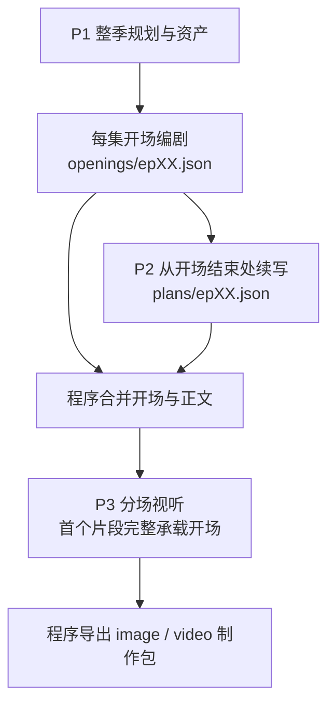
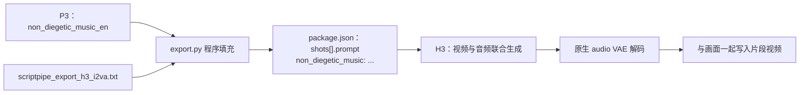

# 长链路 prompt 与声音调试

正式文件位于 `prompt/script/`。`--long` 默认执行 P1 整季、每集开场、P2 正文续写、P3 每场视听，随后程序导出；P4/P5 由 `--long-review report` 按需执行一次。`quality.json` 中的 `llm_review` 区分 skipped 与 reported。

## 每集开场在哪里调

[开场 prompt](../prompt/script/scriptpipe_long_episode_opening_zh.txt) 负责每集首个视频片段的对白、独白和动作。任务部分定义开场的作用、声画冲击、局面变化和追看理由；逐字段部分分别指导实际动作与台词。



每集的开场完成后立即进入该集 P2，各集并发遵循现有 `--concurrency`。开场只接收本集规划、对应原文片段、精简资产目录和必要制作参数。P3 接收合并后的本场事件及相关资产。

首镜范围为 5 秒至单次请求上限与 10 秒的较小值，记录在 `creative_brief.json.opening_duration_range_seconds`；默认 B200 配置为 `[5, 9.4]`。开场编剧据此安排内容，P3 选择具体时长。程序将开场事件固定为首个片段，后续片段承载正文。

`openings/epXX.json` 保存开场原文；`plans/epXX.json` 保存 P2 的后续正文。正文继续发生在同一地点和时段时，P2 续写 scene01，沿用开场场景信息并补充后续人物、道具；发生地点或时段变化时，正文从 scene02 开始。程序合并后交给 P3，带实际镜号范围的完整计划保存到 `assembled_plans/epXX.json`。

`openings/` 是 scriptpipe 内部创作与续跑缓存。最终交付中，开场已经作为每集第一镜合入 `episodes/epXX/script.md`、`storyboard.json`、`package.json` 和 `image_slots.json`，全季 `screenplay.md` 也包含完整开场。imagepipe 读取交付包中的图片清单与季设定，videopipe 读取每集制作包、剧本、配置与绑定图片；两者沿用现有入口消费包含开场的完整内容。

只生成开场供检查：

```bash
scriptpipe --long --source /data/novel.txt --output /data/runs/script-opening --stop-after openings
```

检查后去掉 `--stop-after openings`，其余参数与输出目录保持一致，即可复用开场继续。更换 prompt 或修改开场创作要求后，使用新的输出目录生成对应正文与视听稿。

## 对白与内心独白在哪里调

| 字段路径 | 内容说明 | 下游消费者 | 产出方 |
| ---- | ---- | ----- | --- |
| `openings/epXX.json.events[].text_zh` | 开场实际对白与内心独白，调整措辞、回应和冲击力 | P2 续写、P3 引用、程序导出 | [开场编剧](../prompt/script/scriptpipe_long_episode_opening_zh.txt) |
| `openings/epXX.json.events[].voiceover` | 开场的现场发言或画外音属性 | P3、H3、字幕 | [开场编剧](../prompt/script/scriptpipe_long_episode_opening_zh.txt) |
| `openings/epXX.json.events[].action_zh` | 开场的具体行为、交锋与局面变化 | P2 续写、P3 视听执行 | [开场编剧](../prompt/script/scriptpipe_long_episode_opening_zh.txt) |
| `plans/epXX.json.scenes[].events[].text_zh` | 开场之后的逐字对白与独白 | P3 引用、程序导出 | [P2 分集正文](../prompt/script/scriptpipe_long_episode_plan_zh.txt) |
| `plans/epXX.json.scenes[].events[].voiceover` | 正文的现场发言或画外音属性 | P3、H3、字幕 | [P2 分集正文](../prompt/script/scriptpipe_long_episode_plan_zh.txt) |
| `season.json.characters[].dramatic_profile_zh` | 人物动机、应对压力的方式和说话特点 | 开场编剧、P2 | [P1 整季规划](../prompt/script/scriptpipe_long_season_plan_zh.txt) |
| `season.json.characters[].voice_en` | 稳定的音高、音色、质感、口音 | P3、H3 | [P1 整季规划](../prompt/script/scriptpipe_long_season_plan_zh.txt) |
| `scenes/epXX/*.json.shots[].event_refs[].delivery_en` | 当前一句的语速、气息、重音、音量、接话与停顿 | H3 | [P3 分场视听](../prompt/script/scriptpipe_long_scene_write_zh.txt) |

修改开场“人物实际说什么”，调整开场 prompt 的 `events[].text_zh`；修改后续正文，调整 P2 的 `scenes[].events[].text_zh`。修改“说出来听起来怎样”，调整 P1 音色或 P3 发声表演。每个字段使用 `##` 标题，具体指导以 `*` 分项。

P3 用 `event_id` 引用程序合并的正式稿，开场采用 `opening_ev` 前缀，正文采用 `ev` 前缀。程序把 `speaker_id/text_zh/voiceover` 填入最终镜头对象，再编译成 H3 的 `<d>` 台词块。中文可读剧本也从这份事件生成。声画外音会在 H3 prompt 中指明 off-screen voiceover，并说明该人物出镜时嘴唇闭合。

作品专属要求可写到 `--notes`，各阶段按自己的字段职责使用。例如对白的表达偏好、某个人物的内心独白用途、作品的配乐乐器与节奏，都可以通过同一个 notes 文件提供。

## H3 的 BGM 接口

H3 支持视频与原生立体声音频联合生成；官方提示词将背景配乐单列为 `non_diegetic_music`，按乐器、速度、节奏与强弱变化描述，无配乐时用 `N/A`。[模型说明](https://huggingface.co/MiniMaxAI/MiniMax-H3)、[提示词说明 §4.7](https://huggingface.co/MiniMaxAI/MiniMax-H3/blob/main/docs/VIDEO_PROMPT_WRITING_GUIDE_base_en.md)

当前接入路径是：



P3 每个片段明确填写 `shots[].non_diegetic_music_en`，并在字段下指导乐器、节奏、进入点、强弱和与人声的关系。当前样例包括开场的打击重音与低音脉冲、辞退威胁时低弦进入、录音手机落桌时音乐停下，以及反击动作上的短促拨弦重音。实际创作由本场内容与 notes 决定。

最终 H3 prompt 的一段原创示例：

```text
non_diegetic_music: Sparse low piano notes at a slow, even pulse, kept soft beneath the clearly audible voices. The notes stop when the phone touches the desk.
```

环境声、脚步和拟音由 P3 `soundscape_en` 进入 `overall_soundscape`；人物能听见的收音机或现场演奏随剧情写入视听正文。三类声音各有自己的描述入口。[提示词说明 §4.6–4.7](https://huggingface.co/MiniMaxAI/MiniMax-H3/blob/main/docs/VIDEO_PROMPT_WRITING_GUIDE_base_en.md)

`production.yaml` 的 `script.non_diegetic_music` 是导出器在片段缺少配乐字段时使用的备用值。当前默认是 `N/A`，长链路会由 P3 明确写出每段实际选择，覆盖该备用值。要让某作品全程无配乐，在 notes 中明确要求所有片段的配乐为 `N/A`。

现有 `h3_i2v.json` 已把 `VAEDecodeAudio` 接入视频保存节点，配乐指导沿当前 prompt 即可进入模型。片段目前独立生成，复用乐器与节奏描述能提出一致的声音目标；整集旋律连续、节拍严格衔接或独立音轨混音还需要音频接续或后期处理，当前实现未验证这些效果。

## 与图片、视频的交接

P1 的外貌、服装、地点和道具编译为共享参考图任务；P3 首帧描述与角色、服装、道具引用编译为逐镜首帧任务。`scene_anchor_shot_id` 指定同场参考首帧。imagepipe 依此生成图片并把共享图复制到单集目录。

videopipe 读取每集 `package.json`、`script.md`、`production.yaml` 与绑定图片。H3 使用绑定为 `first_frame` 的图片；其余共享图仍按现有 `review_only` 角色交给后续视频审核。imagepipe 本身没有图像评审阶段。

接口验证使用正式 prompt 的 JSON 示例运行真实装配与导出，将交付目录移到独立位置并移除全部 scriptpipe 运行缓存，再由 imagepipe 编译依赖、处理测试图片的复制，最后由 videopipe 载入带图制作包并检查制作参数。验证包含开场原文完整进入每集首镜、台词逐字传递、独白标记、BGM 编译和首帧引用。模型生成的视觉、语音与音乐效果需要实际生成样片评估。

应用新格式时使用新的 scriptpipe 输出目录；同一次任务的续跑继续复用该目录。已有整集 P2 稿与本版“独立开场 + 正文续写”的缓存含义不同。
